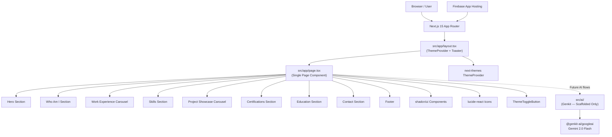

# Architecture

> **Last Verified**: 2026-11-09  
> **Source**: `src/app/layout.tsx`, `src/app/page.tsx`, `next.config.ts`, `tailwind.config.ts`

---

## Summary

This is a **single-page Next.js application** using the App Router. There is no database, no backend API layer, and no authentication. The entire portfolio renders from a single route (`/`) with all content hardcoded as TypeScript data arrays in `src/app/page.tsx`.

---

## High-Level Architecture Diagram



---

## Rendering Strategy

| Aspect | Detail |
|--------|--------|
| Rendering | `'use client'` — the entire page is a Client Component |
| Server Components | Only `layout.tsx` is a Server Component |
| Hydration | Standard React hydration on the client |
| Routing | Single route only (`/`) — no sub-pages |
| Data Fetching | None — all data is hardcoded in the component file |

> **Note**: `page.tsx` uses `'use client'` directive because it requires `useState` and `useEffect` for carousel state and theme detection. This means the entire page re-renders on the client, which is appropriate for a static personal portfolio with interactive carousels.

---

## Component Hierarchy

```
RootLayout (Server Component)
└── html[lang="en"]
    └── body
        └── ThemeProvider (Client Component via next-themes)
            ├── <children> = Home() (Client Component)
            │   ├── <style jsx global> — inline CSS for 3D transforms
            │   ├── <header> (sticky)
            │   │   ├── Logo
            │   │   ├── Desktop <nav>
            │   │   ├── ThemeToggleButton
            │   │   └── Sheet (mobile menu)
            │   ├── <main>
            │   │   ├── Section: #home (Hero)
            │   │   │   ├── Hero text + CTA buttons
            │   │   │   ├── Profile Image (next/image)
            │   │   │   └── Technology icon ticker
            │   │   ├── Section: #WHO AM I
            │   │   ├── Section: #work-experience
            │   │   │   └── ExperienceCard × 5 (Carousel)
            │   │   ├── Section: #skills
            │   │   │   └── Core Competencies ticker
            │   │   ├── Section: #projects
            │   │   │   └── ProjectCard × 3 (Flippable Carousel)
            │   │   ├── Section: #certifications
            │   │   ├── Section: #education
            │   │   └── Section: #contact
            │   └── <footer>
            └── Toaster (Client Component)
```

---

## State Architecture

All state lives inside `Home()` in `src/app/page.tsx`. There is no global state manager (no Zustand, Redux, Context for content).

| State Variable | Type | Purpose |
|---------------|------|---------|
| `currentExperienceIndex` | `number` | Active card in Work Experience carousel |
| `currentProjectIndex` | `number` | Active card in Project carousel |
| `isMobileMenuOpen` | `boolean` | Controls Sheet (mobile menu) open state |
| `isFlipped` (per ProjectCard) | `boolean` | 3D flip state, local to each ProjectCard instance |

See [STATE_MANAGEMENT.md](./STATE_MANAGEMENT.md) for full details.

---

## Styling Architecture

| Layer | Detail |
|-------|--------|
| Base | Tailwind CSS 3 utility classes |
| Component Layer | shadcn/ui (Radix UI primitives + CVA variants) |
| Design Tokens | CSS custom properties defined in `globals.css` |
| Theme | Dual theme (light/dark), monochromatic grayscale palette |
| Custom CSS | Inline `<style jsx global>` in page.tsx for 3D card transforms and animations |
| Custom Tailwind | `slideLeft` keyframe animation, `scrollbar-hide`, `pause` utilities in `tailwind.config.ts` |
| Font | Inter (Google Fonts via `next/font/google`) |

---

## AI Layer Architecture

The AI layer is scaffolded but contains no active flows.

| File | Role |
|------|------|
| `src/ai/ai-instance.ts` | Creates and exports the Genkit `ai` instance configured with Google AI (Gemini 2.0 Flash) |
| `src/ai/dev.ts` | Entry point for `genkit start` dev server — currently empty (no flows imported) |

The `GOOGLE_GENAI_API_KEY` environment variable is required for the AI layer to function.

---

## Hosting Architecture

- Platform: **Firebase App Hosting**
- Firebase Project ID: `aasim-malik-portfolio-dg25v`
- Deployment: `firebase deploy` from CLI
- The `.idx/dev.nix` file configures the Firebase Studio / Project IDX environment with Node.js 20

---

## No Backend / No Database

This portfolio has:
- ❌ No API routes (`src/app/api/` does not exist)
- ❌ No database (Firestore rules, Cloud SQL, or otherwise)
- ❌ No authentication
- ❌ No server actions
- ❌ No form submission handling (contact uses mailto/social links)

---

## Related Documents

- [FRONTEND.md](./architecture/FRONTEND.md)
- [INFRASTRUCTURE.md](./architecture/INFRASTRUCTURE.md)
- [STATE_MANAGEMENT.md](./STATE_MANAGEMENT.md)
- [TECH_STACK.md](./TECH_STACK.md)
- [DATA_FLOW.md](./DATA_FLOW.md)
