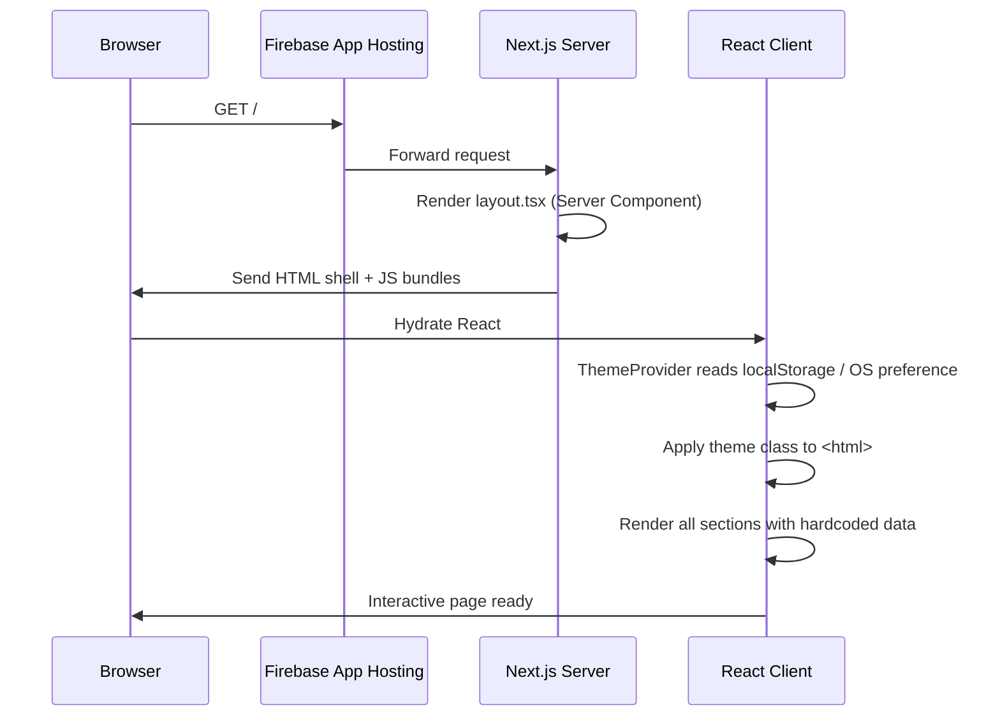
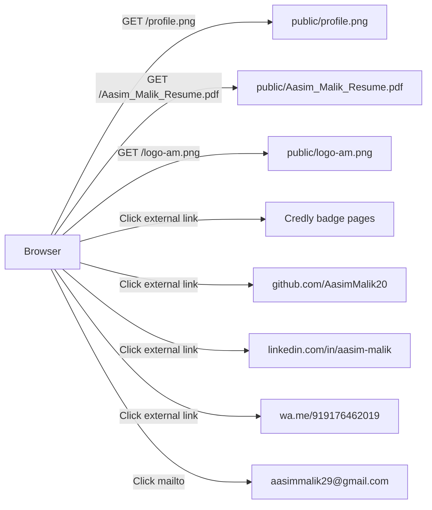
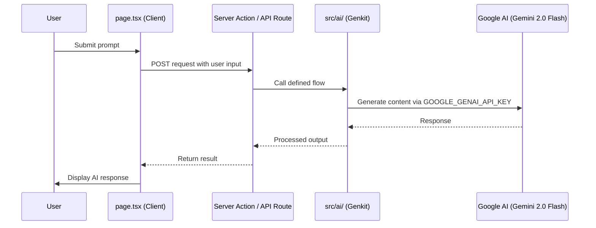

# Data Flow

> **Last Verified**: 2026-11-09  
> **Source**: `src/app/page.tsx`, `src/app/layout.tsx`

---

## Summary

This portfolio has **no dynamic data flow**. All content is hardcoded as TypeScript arrays and objects in `src/app/page.tsx`. There are no API calls, no database reads, and no server-side data fetching at runtime.

---

## Request/Response Flow

---

## Static Assets Flow

---

## Data Sources (All Hardcoded in `page.tsx`)

| Data Structure | Type | Description |
|---------------|------|-------------|
| `technologies` | Array of `{name, icon}` | 11 tech items for hero ticker |
| `categorizedSkills` | Object keyed by category | 9 categories with skill string arrays |
| `coreCompetencies` | `string[]` | 14 soft skills/competency strings |
| `coreExperiences` | Array of objects | 5 condensed experience items for WHO AM I section |
| `workExperiences` | Array of objects | 5 detailed experience items with bullet points |
| `projects` | Array of objects | 3 project items with tags and optional links |
| `certifications` | Array of objects | 6 certification items with external links |

---

## No Dynamic Data Paths

There are **no** data flow paths for:
- ❌ Contact form submission (no POST route)
- ❌ Database reads (no Firestore queries)
- ❌ External API calls from the client
- ❌ Server Actions
- ❌ AI flow invocations (Genkit flows not yet defined)
- ❌ Analytics tracking
- ❌ Search
- ❌ Authentication

---

## Future Data Flow (If AI Features Are Added)

If Genkit flows are added, the flow would be:

---

## Related Documents

- [ARCHITECTURE.md](./ARCHITECTURE.md)
- [STATE_MANAGEMENT.md](./STATE_MANAGEMENT.md)
- [API_REFERENCE.md](./API_REFERENCE.md)
- [features/FEAT-012-ai-genkit.md](./features/FEAT-012-ai-genkit.md)
