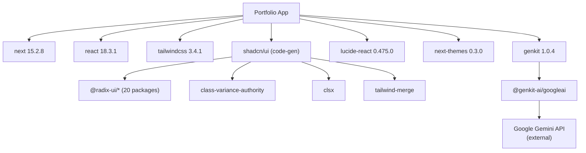

# Dependency Map

> **Last Verified**: 2026-11-09  
> **Source**: `package.json`, `package-lock.json`

---

## Summary

The project has **42 direct production dependencies** and **6 dev dependencies**. Many are scaffolded by Firebase Studio and not actively used in the current portfolio page.

---

## Dependency Usage Classification

### ACTIVELY USED

These dependencies are imported and used in the current codebase.

| Package | Version | Used In | Purpose |
|---------|---------|---------|---------|
| `next` | 15.2.8 | Throughout | Framework |
| `react` | ^18.3.1 | Throughout | UI library |
| `react-dom` | ^18.3.1 | `layout.tsx` | DOM rendering |
| `typescript` | ^5 | Entire codebase | Type safety |
| `tailwindcss` | ^3.4.1 | All TSX files | Styling |
| `tailwindcss-animate` | ^1.0.7 | `tailwind.config.ts` | Animation utilities |
| `clsx` | ^2.1.1 | `src/lib/utils.ts` | Class merging |
| `tailwind-merge` | ^3.0.1 | `src/lib/utils.ts` | Tailwind class conflict resolution |
| `class-variance-authority` | ^0.7.1 | shadcn/ui components | Variant management |
| `lucide-react` | ^0.475.0 | `page.tsx` | Icons (30+ icons used) |
| `next-themes` | ^0.3.0 | `theme-provider.tsx`, `theme-toggle-button.tsx` | Dark/light theme |
| `@radix-ui/react-dialog` | ^1.1.6 | `ui/dialog.tsx`, `ui/sheet.tsx` | Mobile menu Sheet |
| `@radix-ui/react-toast` | ^1.2.6 | `ui/toast.tsx`, `ui/toaster.tsx` | Toast notifications |
| `@radix-ui/react-separator` | ^1.1.2 | `ui/separator.tsx` | Visual separators |
| `@radix-ui/react-slot` | ^1.1.2 | `ui/button.tsx` | Button `asChild` pattern |
| `@radix-ui/react-tooltip` | ^1.1.8 | `ui/tooltip.tsx` | Tooltips |
| `genkit` | ^1.0.4 | `src/ai/ai-instance.ts` | AI orchestration framework |
| `@genkit-ai/googleai` | ^1.0.4 | `src/ai/ai-instance.ts` | Google AI plugin |
| `@genkit-ai/next` | ^1.0.4 | (scaffolded) | Next.js Genkit integration |

---

### INSTALLED BUT NOT ACTIVELY USED (Scaffold Dependencies)

These are installed but not imported anywhere in current source files.

| Package | Likely Intended Use | Notes |
|---------|--------------------|----|
| `firebase` | ^11.3.0 | Firestore, Auth, etc. | Not imported anywhere — scaffold only |
| `@tanstack/react-query` | ^5.66.0 | Server state management | Not used |
| `@tanstack-query-firebase/react` | ^1.0.5 | Firebase + React Query | Not used |
| `react-hook-form` | ^7.54.2 | Contact form | No form exists yet |
| `@hookform/resolvers` | ^4.1.3 | Form validation | No form exists yet |
| `zod` | ^3.24.2 | Schema validation | Not used |
| `recharts` | ^2.15.1 | Charts | Not used |
| `date-fns` | ^3.6.0 | Date formatting | Not used |
| `react-day-picker` | ^8.10.1 | Date picker | Not used |
| `patch-package` | ^8.0.0 | Patching npm packages | No patches |

---

### RADIX UI COMPONENTS INSTALLED BUT NOT DIRECTLY USED IN PAGE

These Radix primitives are installed and available as shadcn/ui components, but the shadcn components themselves are only used if called in `page.tsx`.

| Package | shadcn Component | Used in page? |
|---------|-----------------|---------------|
| `@radix-ui/react-accordion` | `Accordion` | ❌ |
| `@radix-ui/react-alert-dialog` | `AlertDialog` | ❌ |
| `@radix-ui/react-avatar` | `Avatar` | ❌ |
| `@radix-ui/react-checkbox` | `Checkbox` | ❌ |
| `@radix-ui/react-dropdown-menu` | `DropdownMenu` | ❌ |
| `@radix-ui/react-label` | `Label` | ❌ |
| `@radix-ui/react-menubar` | `Menubar` | ❌ |
| `@radix-ui/react-popover` | `Popover` | ❌ |
| `@radix-ui/react-progress` | `Progress` | ❌ |
| `@radix-ui/react-radio-group` | `RadioGroup` | ❌ |
| `@radix-ui/react-scroll-area` | `ScrollArea` | ❌ |
| `@radix-ui/react-select` | `Select` | ❌ |
| `@radix-ui/react-slider` | `Slider` | ❌ |
| `@radix-ui/react-switch` | `Switch` | ❌ |
| `@radix-ui/react-tabs` | `Tabs` | ❌ |

> The shadcn/ui components used in `page.tsx` are: `Card`, `Button`, `Badge`, `Sheet`, `Separator`

---

## Dev Dependencies

| Package | Version | Purpose |
|---------|---------|---------|
| `@types/node` | ^20 | TypeScript types for Node.js |
| `@types/react` | ^18 | TypeScript types for React |
| `@types/react-dom` | ^18 | TypeScript types for React DOM |
| `genkit-cli` | ^1.0.4 | CLI for Genkit dev server (`genkit start`) |
| `postcss` | ^8 | CSS processing |
| `tailwindcss` | ^3.4.1 | Tailwind CSS framework |

---

## Dependency Graph (Core)

---

## Related Documents

- [TECH_STACK.md](./TECH_STACK.md)
- [rules/DEPENDENCY_RULES.md](./rules/DEPENDENCY_RULES.md)
- [TECHNICAL_DEBT.md](./TECHNICAL_DEBT.md)
