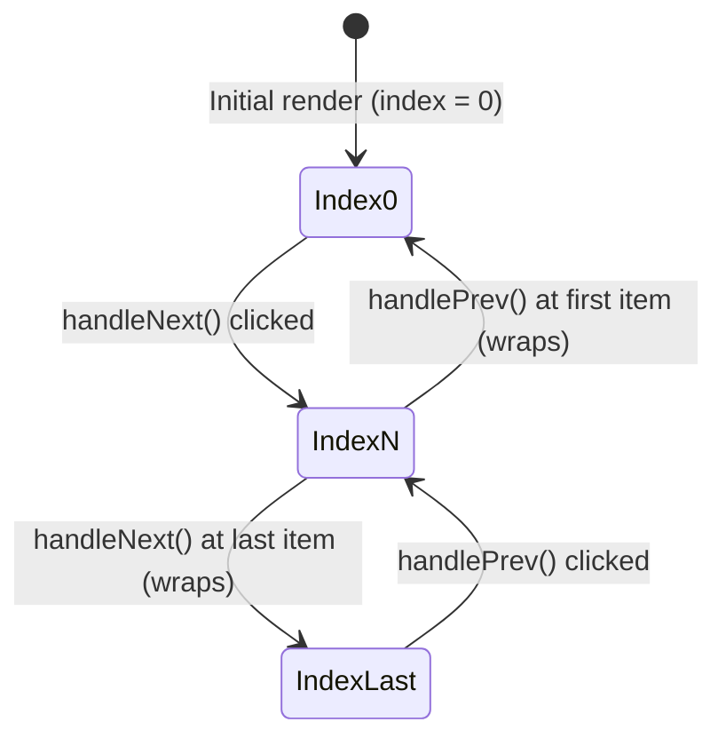
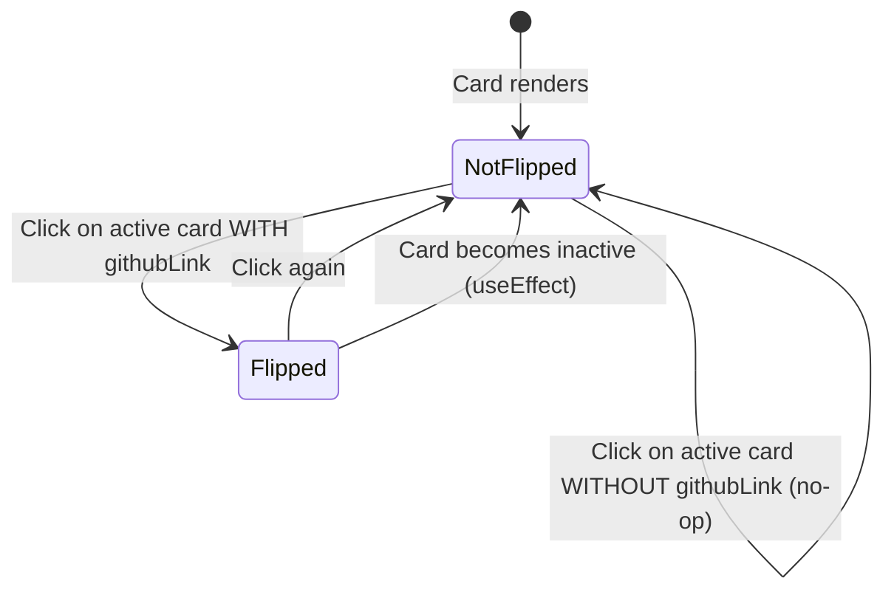

# State Management

> **Last Verified**: 2026-11-09  
> **Source**: `src/app/page.tsx`, `src/hooks/use-toast.ts`, `src/components/theme-provider.tsx`

---

## Summary

This application uses **local React state only**. There is no global state manager (no Redux, Zustand, Context API for content). All interactive state is scoped to component instances.

---

## State Inventory

### `Home()` Component State (`src/app/page.tsx`)

| Variable | Type | Initial Value | Purpose |
|----------|------|---------------|---------|
| `currentExperienceIndex` | `number` | `0` | Index of active card in Work Experience carousel |
| `currentProjectIndex` | `number` | `0` | Index of active card in Project carousel |
| `isMobileMenuOpen` | `boolean` | `false` | Controls Sheet (mobile menu) open/close |

### `ProjectCard` Component State (`src/app/page.tsx`)

Each `ProjectCard` instance has its own state:

| Variable | Type | Initial Value | Purpose |
|----------|------|---------------|---------|
| `isFlipped` | `boolean` | `false` | Whether the card is showing its back face (GitHub link) |

**Side effect**: `useEffect` watches `isActive` prop — if the card becomes inactive, `isFlipped` resets to `false`.

---

## Theme State (External — next-themes)

Managed entirely by the `next-themes` library, accessed via `useTheme()` hook.

| Aspect | Detail |
|--------|--------|
| Provider | `ThemeProvider` in `layout.tsx` wraps the entire app |
| Attribute | `class` — adds `dark` class to `<html>` element |
| Default | `system` — respects OS preference |
| Persistence | Stored in `localStorage` |
| Hook | `useTheme()` → `{ theme, setTheme, resolvedTheme }` |
| Used in | `ThemeToggleButton` reads `resolvedTheme`, calls `setTheme` |

---

## Toast State (External — use-toast.ts)

Custom implementation inspired by react-hot-toast, not connected to any external store.

| Aspect | Detail |
|--------|--------|
| Storage | Module-level `memoryState` (not persisted) |
| Limit | `TOAST_LIMIT = 1` (only 1 toast shown at a time) |
| Auto-remove delay | `TOAST_REMOVE_DELAY = 1000000ms` (effectively permanent until dismissed) |
| Access | `useToast()` hook or `toast()` function |
| Used in | Toaster component in `layout.tsx` — but no toasts are currently triggered in the portfolio |

---

## State Flow Diagrams

### Carousel State

### Card Flip State (ProjectCard)

---

## What State Does NOT Exist

- ❌ No form state (no contact form)
- ❌ No server state (no React Query, no SWR fetching)
- ❌ No persisted user preferences beyond theme
- ❌ No authentication state
- ❌ No loading or error state

---

## Recommendations (INFERRED)

If a contact form is added in the future:
- Use `react-hook-form` + `zod` (already installed) for form state
- Handle submission via a Next.js Server Action or API route

---

## Related Documents

- [ARCHITECTURE.md](./ARCHITECTURE.md)
- [features/FEAT-003-work-experience.md](./features/FEAT-003-work-experience.md)
- [features/FEAT-005-projects.md](./features/FEAT-005-projects.md)
- [features/FEAT-009-theme-toggle.md](./features/FEAT-009-theme-toggle.md)
