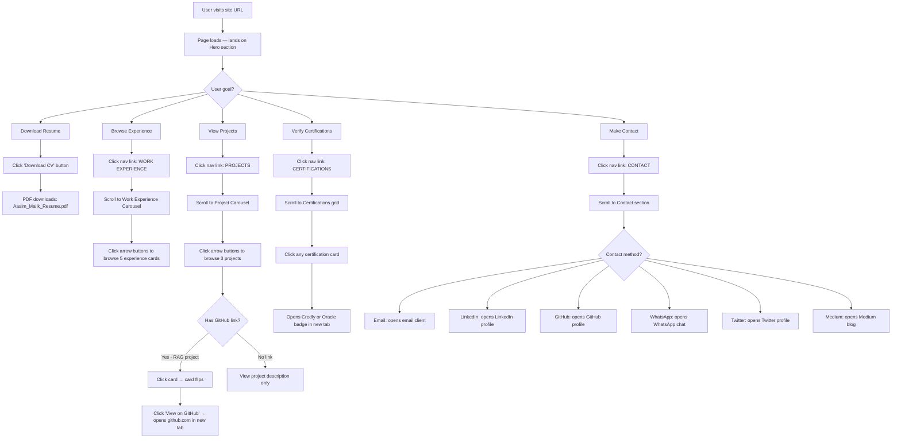
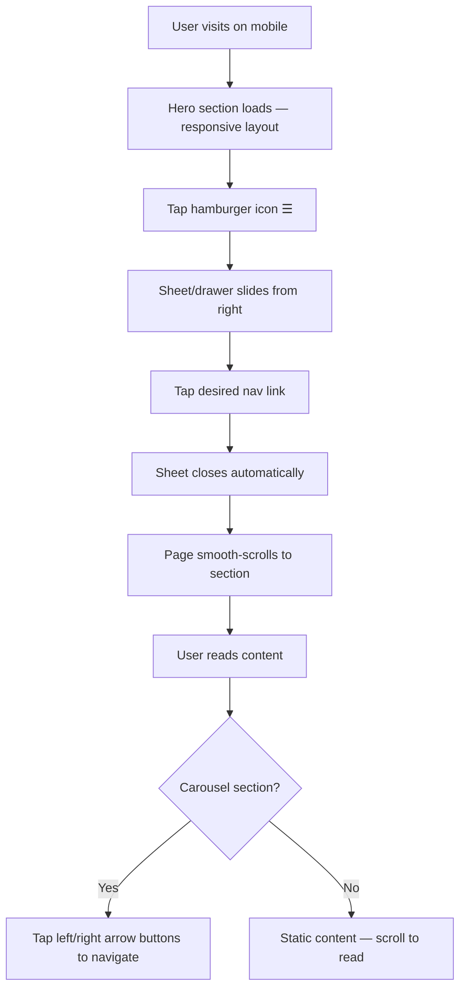
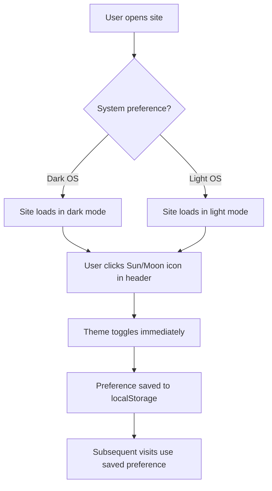
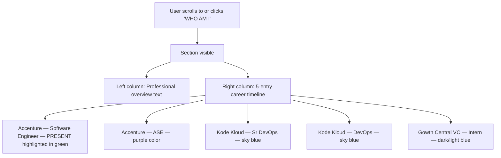

# User Flows

> **Last Verified**: 2026-11-09  
> **Source**: `src/app/page.tsx`

---

## Flow 1: Standard Page Visit (Desktop)

---

## Flow 2: Mobile Visit

---

## Flow 3: Theme Toggle

---

## Flow 4: Career Timeline Navigation (WHO AM I)

---

## Key Interaction Rules

| Interaction | Behavior |
|------------|---------|
| Nav link click | Smooth scroll to section anchor |
| External link click | Opens in new tab (`target="_blank"`) |
| "Get In Touch" button | Smooth scroll to `#contact` |
| "Download CV" button | Browser downloads PDF |
| Carousel prev/next | Circular wrap — last item wraps to first |
| Project card click (active, has link) | 3D flip reveals GitHub button |
| Project card click (inactive) | No action (pointer-events: none) |
| Project card click (no github link) | No flip, no action |
| Mobile menu link tap | Menu closes, page scrolls to section |
| Technology/competency ticker hover | Animation pauses |

---

## Related Documents

- [FEATURES.md](./FEATURES.md)
- [PRD.md](./PRD.md)
- [STATE_MANAGEMENT.md](./STATE_MANAGEMENT.md)
